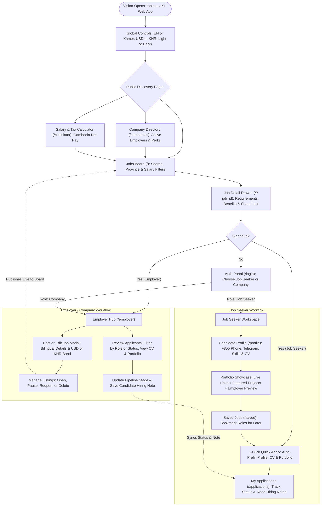
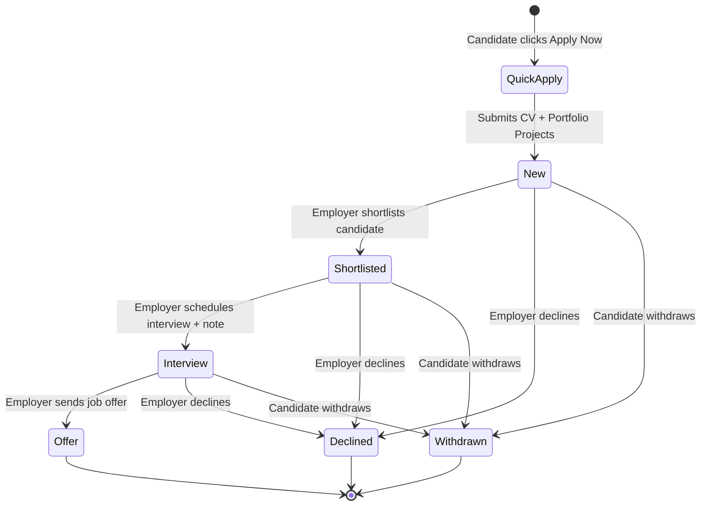
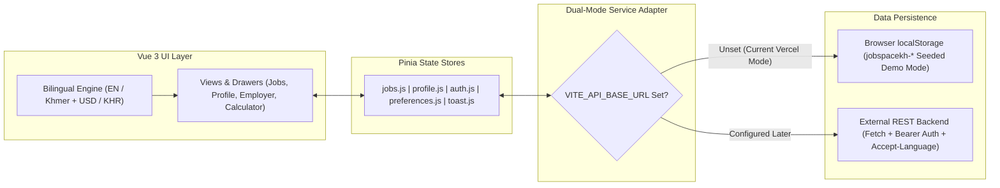
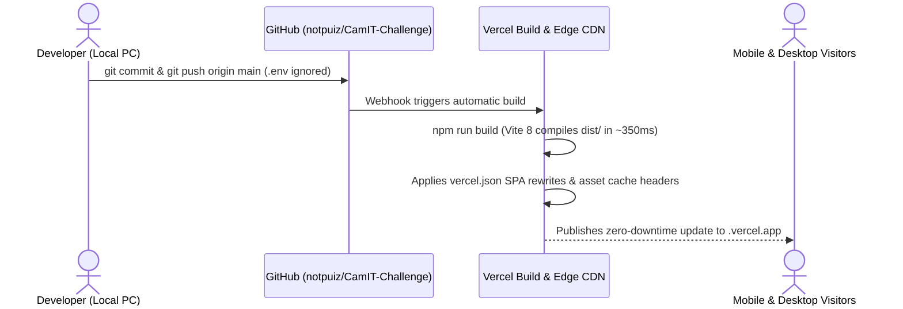

# JobspaceKH — System Workflow, Flowcharts & Project Proposal

> [!NOTE]
> This document contains two complete sections you can use directly for your **CamIT-Challenge** documentation, presentation slides, or capstone report:
> 1. **System Workflow & Architecture Flowcharts** — how users, data, and deployments flow through **JobspaceKH**.
> 2. **Formal Project Proposal** — problem statement, solution overview, target personas, scope, technical architecture, and future roadmap.

---

## Part 1: Project Workflow & Flowcharts

### 1.1 End-to-End User Journey Flowchart

When someone opens **JobspaceKH**, anyone can immediately browse jobs, companies, and the Cambodia salary tax calculator in **English** or **ខ្មែរ (Khmer)** and toggle salaries between **USD (`$`)** and **Khmer Riel (`៛`)**. Signing in unlocks role-specific workflows for **Job Seekers** and **Employers / Companies**.

---

### 1.2 Step-by-Step Workflow Breakdown

#### A. Public Discovery Workflow *(No Login Required)*
1. ** Boot & Preferences** ([index.html](file:///d:/CamIT/CamIT/index.html), [preferences.js](file:///d:/CamIT/CamIT/src/stores/preferences.js), [useTheme.js](file:///d:/CamIT/CamIT/src/composables/useTheme.js)): Restores saved theme (`jobspacekh-theme`), language (`jobspacekh-locale`), and currency (`jobspacekh-currency`) before first paint so there is zero flash.
2. **Search & Multi-Criteria Filtering** ([JobFilterBar.vue](file:///d:/CamIT/CamIT/src/components/jobs/JobFilterBar.vue), [JobsBoardView.vue](file:///d:/CamIT/CamIT/src/views/JobsBoardView.vue)): Filters listings in real time by keyword (matching both English and Khmer fields via precomputed `searchText`), industry, Cambodia province, work mode (`On-site`, `Hybrid`, `Remote`), job type, experience level, and salary range.
3. **Salary & Tax Estimation** ([SalaryCalculatorView.vue](file:///d:/CamIT/CamIT/src/views/SalaryCalculatorView.vue), [currency.js](file:///d:/CamIT/CamIT/src/utils/currency.js)): Calculates Cambodian monthly resident salary tax across progressive KHR brackets (`0%` to `20%`), subtracts dependent spouse/child allowances (`150,000 ៛` each), and links directly to matching salary-bracket jobs.

#### B. Job Seeker Workflow (`/profile` → `/` → `/applications`)
1. **Profile & Portfolio Setup** ([CandidateProfileView.vue](file:///d:/CamIT/CamIT/src/views/CandidateProfileView.vue)): Candidates save their Cambodia phone (`+855`), Telegram handle (`@username`), skills, default CV filename, social links (`Portfolio`, `GitHub`, `LinkedIn`), and **Featured Portfolio Projects** (title, role, live URL, tech stack, summary). They can switch to **Employer Preview** to see exactly how recruiters view their card.
2. **Quick Apply with Return-Intent Memory** ([JobDetailDrawer.vue](file:///d:/CamIT/CamIT/src/components/jobs/JobDetailDrawer.vue), [auth.js](file:///d:/CamIT/CamIT/src/stores/auth.js)): If a logged-out visitor clicks **Apply now** on a job, `authStore` remembers `reopenJobId` and `openApplyOnReturn`. Right after signing in on [LoginView.vue](file:///d:/CamIT/CamIT/src/components/auth/LoginView.vue), the app automatically returns to the board, reopens that exact job drawer, and pre-fills their saved profile and portfolio projects.
3. **Application Tracking** ([CandidateApplicationsView.vue](file:///d:/CamIT/CamIT/src/components/jobs/CandidateApplicationsView.vue)): Candidates filter submitted applications by status, read interview/hiring notes left by the employer, or withdraw an application.

#### C. Employer / Company Workflow (`/employer`)
1. **Job Publishing & Lifecycle Control** ([EmployerWorkspaceView.vue](file:///d:/CamIT/CamIT/src/components/employer/EmployerWorkspaceView.vue), [PostJobModal.vue](file:///d:/CamIT/CamIT/src/components/employer/PostJobModal.vue)): Companies publish new roles in USD or KHR, edit live listings, pause roles temporarily (hiding them from public search without losing applicants), reopen them, or delete them.
2. **Applicant & Portfolio Review**: Employers search applicants by name, email, or Telegram, inspect attached portfolio projects with 1-click external links, move candidates across hiring stages, and save interview notes visible to the candidate.

---

### 1.3 Candidate Application Lifecycle (`stateDiagram-v2`)

---

### 1.4 Technical Data & Cloud Deployment Workflow

**JobspaceKH** uses a **Dual-Mode Service Layer** ([camitApi.js](file:///d:/CamIT/CamIT/src/services/camitApi.js) + [apiClient.js](file:///d:/CamIT/CamIT/src/services/apiClient.js)) so it works out-of-the-box on Vercel without a backend server, while remaining ready to connect to any REST API via a single environment variable (`VITE_API_BASE_URL`).

#### GitHub-to-Vercel Continuous Deployment (`sequenceDiagram`)

---

## Part 2: Project Proposal — **JobspaceKH**

### 1. Project Overview

| Field | Details |
| :--- | :--- |
| **Project Name** | **JobspaceKH** |
| **Challenge / Track** | CamIT-Challenge — Modern Web Application for Cambodia |
| **Category** | Recruitment, Career Discovery & Talent Portfolio Platform |
| **Supported Languages** | Bilingual: **English (`EN`)** & **Khmer (`ខ្មែរ`)** |
| **Supported Currencies** | Dual Currency: **US Dollar (`$`)** & **Khmer Riel (`៛`)** (`1 USD ≈ 4,000 ៛`) |
| **Repository** | `https://github.com/notpuiz/CamIT-Challenge` |
| **Hosting & CI/CD** | Vercel Global Edge Network (automated GitHub `main` deployments) |

---

### 2. Executive Summary

**JobspaceKH** is a modern, mobile-first bilingual (**English / Khmer**) job discovery and hiring platform purpose-built for **Cambodia's workforce and employers**. Unlike generic international job boards that ignore local hiring habits or traditional local portals with cluttered interfaces and opaque pay, JobspaceKH combines **transparent USD/KHR salary filtering**, a built-in **Cambodia monthly salary tax calculator**, **Telegram-ready candidate profiles with live portfolio showcases**, and a streamlined **Employer Hub** inside a single fast web application.

---

### 3. Problem Statement

Job seekers and hiring teams in Cambodia currently face four practical friction points:

1. **Language & Accessibility Fragmentation**: International platforms (such as LinkedIn) operate almost exclusively in English, while local social-media job posts are unstructured and impossible to filter by province, work mode, or experience level.
2. **Opaque & Mixed-Currency Compensation**: Listings across Cambodia mix **USD (`$`)** and **Khmer Riel (`៛`)**, and gross salary figures rarely tell candidates their actual take-home pay after Cambodia's progressive Resident Salary Tax and family dependent deductions.
3. **Static CVs Hide Real Skills**: Fresh graduates, software engineers, designers, and digital professionals cannot showcase live projects or GitHub repositories inside traditional PDF-only application forms — while Cambodian recruiters rely heavily on **Telegram (`@username`)** and **`+855` phone numbers** for fast outreach.
4. **Sluggish Mobile Web Experience**: Most job seekers in Cambodia browse listings on smartphones, where heavy layouts, desktop-only navigation, and multi-page reloads cause high drop-off before an application is completed.

---

### 4. Proposed Solution & Objectives

**JobspaceKH** addresses all four gaps with clear product goals:

- **Instant Bilingual Experience (`EN` ↔ `ខ្មែរ`)**: Allow every user to switch the entire interface, province names, job categories, and listings between English and Khmer (`Plus Jakarta Sans` + `Kantumruy Pro`) with zero page reload.
- **Transparent Dual-Currency Salaries & Tax Clarity**: Convert all salary ranges live between `$` and `៛`, paired with an interactive **Cambodia Salary & Tax Calculator** so candidates understand net monthly pay before applying.
- **Portfolio-First Candidate Identity**: Empower job seekers to build a reusable profile with featured portfolio projects, live demo links, GitHub/LinkedIn URLs, and Telegram contact details — plus an **Employer Preview** mode and **1-Click Quick Apply**.
- **Frictionless Hiring Pipeline for Cambodian SMEs**: Give companies a clean workspace to post/pause/edit roles, inspect attached candidate portfolios, update hiring stages (`New` → `Shortlisted` → `Interview` → `Offer`), and share interview notes directly with applicants.

---

### 5. Target Users & Personas

| User Group | Example Personas | Key Needs Addressed by JobspaceKH |
| :--- | :--- | :--- |
| **Job Seekers** | University graduates, Vue/React developers, UI/UX designers, accountants, bank officers, hospitality staff across Phnom Penh, Siem Reap, Sihanoukville, Battambang, and Kampot | Mobile-friendly job search, honest USD/KHR salary bands, net salary calculation, portfolio showcase beyond a plain CV, real-time application status updates |
| **Employers & HR** | Cambodian tech startups, digital agencies, commercial banks, telecoms, SMEs | Fast bilingual job posting, pause/reopen controls, organized applicant filtering, direct access to candidate portfolios and Telegram handles |

---

### 6. Core Functional Scope

| Module | Route | Key Capabilities Delivered |
| :--- | :--- | :--- |
| **Jobs Discovery Board** | `/` | Keyword search (`EN` + `ខ្មែរ`), industry/province/work-mode/salary filters, sorting, active filter chips, deep-linkable job drawer (`/?job=...`), job alerts |
| **Saved Bookmarks** | `/saved` | One-tap job bookmarking persisted across sessions for side-by-side comparison |
| **Company Directory** | `/companies` | Aggregates active Cambodian employers, open role counts, salary bands, locations, and employee perks |
| **Salary & Tax Calculator** | `/calculator` | Computes Cambodia progressive monthly salary tax (`0%–20%`), dependent deductions, and net take-home pay in `$` and `៛` |
| **Candidate Profile & Portfolio** | `/profile` | `+855` phone, Telegram `@handle`, skills tags, default CV, portfolio CRUD (title, role, URL, stack, description), profile completion meter, live **Employer Preview** |
| **My Applications** | `/applications` | Real-time status tracking (`New`, `Shortlisted`, `Interview`, `Offer`, `Declined`), employer interview notes, application withdrawal |
| **Employer Hub** | `/employer` | KPI overview, create/edit/pause/reopen/delete job listings, applicant search & filtering, portfolio inspection, stage & hiring note updates |
| **Role-Aware Auth** | `/login` | Job Seeker vs. Company segmented login/signup, password reset flow, return-to-job apply intent memory, 1-click demo accounts |

---

### 7. Technical Architecture & Engineering Quality

- **Frontend Stack**: **Vue 3** (`<script setup>` Composition API), **Vite 8**, **Tailwind CSS v4**, **Pinia** state management, and **Vue Router 5** ([router/index.js](file:///d:/CamIT/CamIT/src/router/index.js)).
- **UI & Mobile-Native Craft**:
  - Hardware-accelerated composite animations (`transform`, `opacity`) and button-originated View Transitions API dark/light mode ([useTheme.js](file:///d:/CamIT/CamIT/src/composables/useTheme.js)).
  - Zero-jank mobile ergonomics: `16px` coarse-pointer form inputs to prevent iOS auto-zoom, capability-gated hover rules (`@media (hover: hover) and (pointer: fine)`), tactile pointer/keyboard press states ([tactilePress.js](file:///d:/CamIT/CamIT/src/utils/tactilePress.js)), and a compact single-button mobile navbar ([AppNavbar.vue](file:///d:/CamIT/CamIT/src/components/layout/AppNavbar.vue)).
- **Backend-Ready Service Abstraction**: Clean separation between UI stores and data persistence via [apiClient.js](file:///d:/CamIT/CamIT/src/services/apiClient.js) and [camitApi.js](file:///d:/CamIT/CamIT/src/services/camitApi.js), enabling instant serverless demos via `localStorage` today and seamless REST API integration tomorrow.
- **Security & DevOps**: Strict `.env*` exclusion in [.gitignore](file:///d:/CamIT/CamIT/.gitignore), automated static analysis (`oxlint` + `eslint` with zero warnings/errors), sub-second Vite production builds, and SPA routing + immutable asset caching via [vercel.json](file:///d:/CamIT/CamIT/vercel.json).

---

### 8. Project Roadmap

| Phase | Milestone | Status | Deliverables |
| :--- | :--- | :--- | :--- |
| **Phase 1** | **Core Platform & Cloud Launch** | **Completed** | Full bilingual (`EN`/`ខ្មែរ`) SPA, dual USD/KHR currency, Cambodia tax calculator, candidate profile & portfolio builder, Employer Hub, mobile-native polish, GitHub + Vercel CI/CD |
| **Phase 2** | **REST Backend & Cloud Storage** | Planned | Connect `VITE_API_BASE_URL` to Node.js/Express or Laravel + PostgreSQL, JWT authentication, and S3/Cloudflare R2 PDF resume uploads |
| **Phase 3** | **Cambodia Ecosystem Integrations** | Planned | Telegram Bot instant notifications for new job matches & interview invites, KHQR employer featured-listing payments, and AI resume-to-job skill matching |

---

### 9. Expected Impact & Success Metrics

1. **Faster Application Completion**: Reduces repeat form typing by **>70%** through saved candidate profiles, default CVs, and 1-click portfolio attachment.
2. **Higher Candidate Evaluation Quality**: Gives Cambodian employers immediate access to live portfolio work alongside CVs and Telegram contact handles.
3. **Inclusive Bilingual Reach**: Makes tech, finance, creative, and operations opportunities equally accessible to Khmer-first and English-speaking talent across Cambodia on any mobile or desktop browser.
