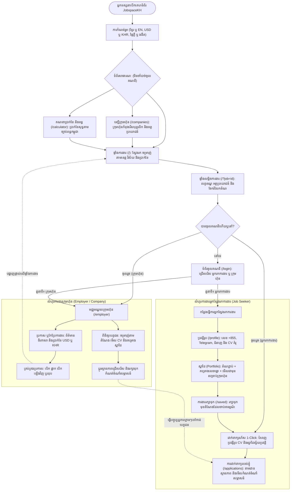
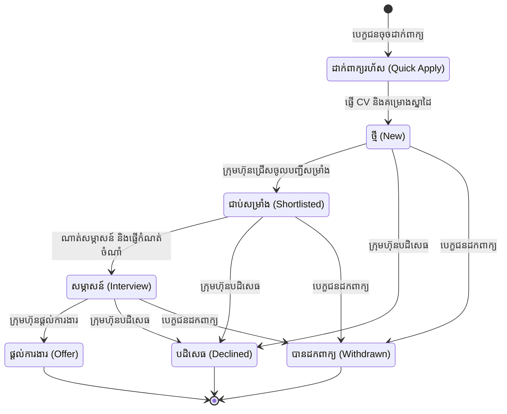
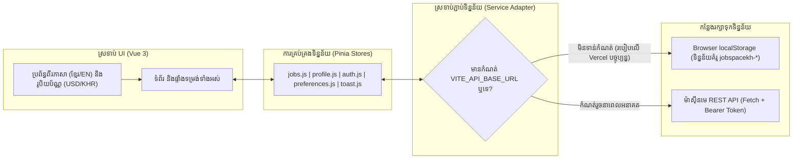
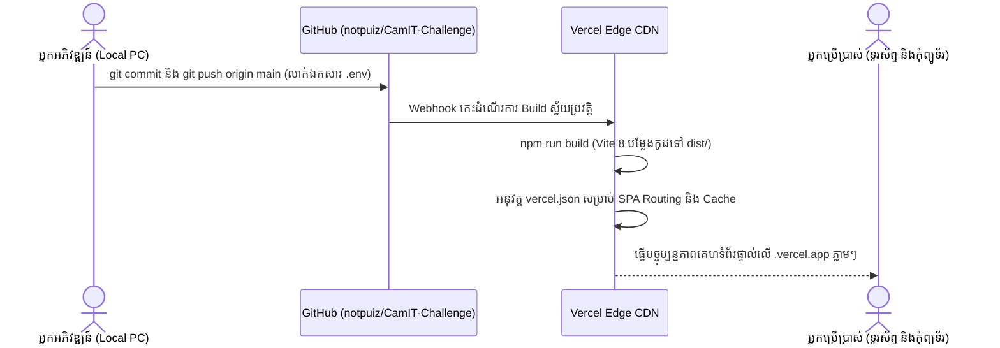

# JobspaceKH — លំហូរការងារនៃប្រព័ន្ធ ដ្យាក្រាមលំហូរ និងសំណើគម្រោង (ភាសាខ្មែរ)

> [!NOTE]
> ឯកសារនេះត្រូវបានរៀបចំជាភាសាខ្មែរផ្លូវការ សម្រាប់ប្រើប្រាស់ក្នុងការដាក់ស្នើប្រកួតប្រជែង **CamIT-Challenge** ស្លាយបទបង្ហាញ (Presentation) ឬរបាយការណ៍សារណា៖
> ១. **លំហូរការងារនៃប្រព័ន្ធ និងដ្យាក្រាមលំហូរ (Workflow & Flowcharts)** — បង្ហាញពីដំណើរការប្រើប្រាស់ ទិន្នន័យ និងការដាក់ឱ្យដំណើរការលើ Cloud។
> ២. **សំណើគម្រោងផ្លូវការ (Project Proposal)** — ចំណោទបញ្ហា ដំណោះស្រាយ គោលបំណង មុខងារសំខាន់ៗ ស្ថាបត្យកម្មបច្ចេកទេស និងផែនការអភិវឌ្ឍន៍បន្ត។

---

## ផ្នែកទី ១៖ លំហូរការងារនៃប្រព័ន្ធ និងដ្យាក្រាមលំហូរ (System Workflow & Flowcharts)

### ១.១ ដ្យាក្រាមលំហូរអ្នកប្រើប្រាស់ទាំងមូល (End-to-End User Journey)

នៅពេលអ្នកប្រើប្រាស់បើកគេហទំព័រ **JobspaceKH** ពួកគេអាចស្វែងរកការងារ មើលបញ្ជីក្រុមហ៊ុន និងគណនាប្រាក់ខែសុទ្ធភ្លាមៗ ដោយប្តូរភាសារវាង **ខ្មែរ (`ខ្មែរ`)** និង **អង់គ្លេស (`EN`)** ព្រមទាំងប្តូររូបិយប័ណ្ណរវាង **ដុល្លារ (`$`)** និង **រៀល (`៛`)**។ ការចូលគណនី (`/login`) នឹងបែងចែកលំហូរការងារជា ២ ផ្នែកគឺ **អ្នកស្វែងរកការងារ (Job Seeker)** និង **ក្រុមហ៊ុនជ្រើសរើសបុគ្គលិក (Employer / Company)**។

---

### ១.២ ការពន្យល់លម្អិតតាមដំណាក់កាលនីមួយៗ

#### ក. ដំណាក់កាលស្វែងរកជាសាធារណៈ *(មិនតម្រូវឱ្យចូលគណនី)*
1. **ការចាប់ផ្តើម និងចំណូលចិត្តអ្នកប្រើប្រាស់** ([index.html](file:///d:/CamIT/CamIT/index.html), [preferences.js](file:///d:/CamIT/CamIT/src/stores/preferences.js), [useTheme.js](file:///d:/CamIT/CamIT/src/composables/useTheme.js))៖ ប្រព័ន្ធចងចាំការកំណត់ផ្ទៃភ្លឺ/ងងឹត (`jobspacekh-theme`) ភាសា (`jobspacekh-locale`) និងរូបិយប័ណ្ណ (`jobspacekh-currency`) តាំងពីមុនពេលបង្ហាញអេក្រង់ដំបូង ដើម្បីកុំឱ្យមានការព្រិចអេក្រង់។
2. **ការស្វែងរក និងចម្រាញ់ពហុលក្ខខណ្ឌ** ([JobFilterBar.vue](file:///d:/CamIT/CamIT/src/components/jobs/JobFilterBar.vue), [JobsBoardView.vue](file:///d:/CamIT/CamIT/src/views/JobsBoardView.vue))៖ អាចស្វែងរកពាក្យគន្លឹះទាំងភាសាខ្មែរ និងអង់គ្លេស ចម្រាញ់តាមវិស័យការងារ រាជធានី-ខេត្ត របៀបធ្វើការ (`នៅការិយាល័យ`, `ចម្រុះ`, `ពីចម្ងាយ`) ប្រភេទការងារ កម្រិតបទពិសោធន៍ និងកម្រិតប្រាក់ខែ។
3. **ការគណនាប្រាក់ខែ និងពន្ធលើប្រាក់បៀវត្សកម្ពុជា** ([SalaryCalculatorView.vue](file:///d:/CamIT/CamIT/src/views/SalaryCalculatorView.vue), [currency.js](file:///d:/CamIT/CamIT/src/utils/currency.js))៖ គណនាពន្ធលើប្រាក់បៀវត្សប្រចាំខែតាមអត្រាកំណើន (`0%` ដល់ `20%`) កាត់កងសហព័ទ្ធ និងកូនក្នុងបន្ទុក (`150,000 ៛` ក្នុងម្នាក់) និងបង្ហាញប្រាក់ខែសុទ្ធជា `$` និង `៛`។

#### ខ. លំហូរការងារអ្នកស្វែងរកការងារ (`/profile` → `/` → `/applications`)
1. **ការបង្កើតប្រវត្តិរូប និងស្នាដៃ (Portfolio)** ([CandidateProfileView.vue](file:///d:/CamIT/CamIT/src/views/CandidateProfileView.vue))៖ បេក្ខជនអាចរក្សាទុកលេខទូរស័ព្ទកម្ពុជា (`+855`) គណនី Telegram (`@username`) ជំនាញ ឯកសារ CV តំណភ្ជាប់ (`Portfolio`, `GitHub`, `LinkedIn`) និងបន្ថែម **គម្រោងស្នាដៃលេចធ្លោ (Featured Projects)** ព្រមទាំងអាចចុច **មើលជាមុនសម្រាប់ក្រុមហ៊ុន (Employer Preview)**។
2. **ការដាក់ពាក្យរហ័ស និងការចងចាំមុខតំណែង** ([JobDetailDrawer.vue](file:///d:/CamIT/CamIT/src/components/jobs/JobDetailDrawer.vue), [auth.js](file:///d:/CamIT/CamIT/src/stores/auth.js))៖ ប្រសិនបើអ្នកប្រើប្រាស់មិនទាន់ចូលគណនីហើយចុច **ដាក់ពាក្យឥឡូវនេះ** ប្រព័ន្ធនឹងចងចាំលេខសម្គាល់ការងារនោះ ហើយបន្ទាប់ពីចូលគណនីនៅលើ [LoginView.vue](file:///d:/CamIT/CamIT/src/components/auth/LoginView.vue) រួច វានឹងបើកទម្រង់ដាក់ពាក្យនោះឡើងវិញដោយបំពេញព័ត៌មាន និងស្នាដៃឱ្យដោយស្វ័យប្រវត្តិ។
3. **ការតាមដានលទ្ធផលដាក់ពាក្យ** ([CandidateApplicationsView.vue](file:///d:/CamIT/CamIT/src/components/jobs/CandidateApplicationsView.vue))៖ តាមដានស្ថានភាពពាក្យស្នើសុំ អានកំណត់ចំណាំណាត់សម្ភាសន៍ពីក្រុមហ៊ុន ឬដកពាក្យស្នើសុំវិញ។

#### គ. លំហូរការងារក្រុមហ៊ុនជ្រើសរើសបុគ្គលិក (`/employer`)
1. **ការប្រកាស និងគ្រប់គ្រងការងារ** ([EmployerWorkspaceView.vue](file:///d:/CamIT/CamIT/src/components/employer/EmployerWorkspaceView.vue), [PostJobModal.vue](file:///d:/CamIT/CamIT/src/components/employer/PostJobModal.vue))៖ ក្រុមហ៊ុនអាចបង្កើតប្រកាសការងារថ្មី កែប្រែព័ត៌មាន ផ្អាកប្រកាសបណ្តោះអាសន្ន (`Paused`) បើកឡើងវិញ (`Open`) ឬលុបប្រកាស។
2. **ការពិនិត្យ CV និងស្នាដៃបេក្ខជន**៖ ស្វែងរកបេក្ខជនតាមឈ្មោះ អ៊ីមែល ឬ Telegram ចុចមើលគម្រោងស្នាដៃដែលបេក្ខជនបានភ្ជាប់ ប្តូរស្ថានភាពជ្រើសរើស និងសរសេរកំណត់ចំណាំសម្ភាសន៍ផ្ញើទៅបេក្ខជន។

---

### ១.៣ វដ្តជីវិតនៃការដាក់ពាក្យការងារ (`stateDiagram-v2`)

---

### ១.៤ ស្ថាបត្យកម្មទិន្នន័យ និងការដាក់ឱ្យដំណើរការស្វ័យប្រវត្តិ (Architecture & CI/CD)

**JobspaceKH** ប្រើប្រាស់ស្រទាប់សេវាកម្មពីររបៀប (**Dual-Mode Service Layer** តាមរយៈ [camitApi.js](file:///d:/CamIT/CamIT/src/services/camitApi.js) និង [apiClient.js](file:///d:/CamIT/CamIT/src/services/apiClient.js)) ដែលអាចដំណើរការលើ Vercel បានភ្លាមៗដោយប្រើ `localStorage` ក្នុងកម្មវិធីរុករក និងអាចភ្ជាប់ទៅកាន់ម៉ាស៊ីនមេ REST API គ្រប់ពេលតាមរយៈអថេរ `VITE_API_BASE_URL` ដោយមិនបាច់កែប្រែកូដផ្នែក UI ឡើយ។

#### លំហូរដាក់ឱ្យដំណើរការស្វ័យប្រវត្តិពី GitHub ទៅ Vercel (`sequenceDiagram`)

---

## ផ្នែកទី ២៖ សំណើគម្រោងផ្លូវការ — **JobspaceKH**

### ១. ព័ត៌មានទូទៅនៃគម្រោង

| ចំណុច | ព័ត៌មានលម្អិត |
| :--- | :--- |
| **ឈ្មោះគម្រោង** | **JobspaceKH** |
| **កម្មវិធីប្រកួតប្រជែង / ប្រធានបទ** | CamIT-Challenge — គេហទំព័រទំនើបសម្រាប់ទីផ្សារការងារនៅកម្ពុជា |
| **ប្រភេទគម្រោង** | ថ្នាលស្វែងរកការងារ ជ្រើសរើសបុគ្គលិក និងបង្ហាញស្នាដៃបេក្ខជន (Job & Portfolio Platform) |
| **ភាសាគាំទ្រ** | ២ ភាសា៖ **ខ្មែរ (`ខ្មែរ`)** និង **អង់គ្លេស (`EN`)** |
| **រូបិយប័ណ្ណគាំទ្រ** | ២ រូបិយប័ណ្ណ៖ **ដុល្លារអាមេរិក (`$`)** និង **ប្រាក់រៀលខ្មែរ (`៛`)** (`1 USD ≈ 4,000 ៛`) |
| **ប្រភពកូដ (GitHub)** | `https://github.com/notpuiz/CamIT-Challenge` |
| **ការបង្ហោះគេហទំព័រ (Hosting)** | Vercel Cloud Edge Network (ភ្ជាប់ការធ្វើបច្ចុប្បន្នភាពស្វ័យប្រវត្តិជាមួយ GitHub) |

---

### ២. សេចក្តីសង្ខេបប្រតិបត្តិ (Executive Summary)

**JobspaceKH** គឺជាគេហទំព័រស្វែងរកការងារ និងជ្រើសរើសបុគ្គលិកពីរភាសា (**ខ្មែរ / អង់គ្លេស**) ដែលត្រូវបានរចនាឡើងយ៉ាងយកចិត្តទុកដាក់សម្រាប់បរិបទទីផ្សារការងារនៅប្រទេសកម្ពុជា។ គម្រោងនេះរួមបញ្ចូលនូវ **ការបង្ហាញប្រាក់ខែប្រកបដោយតម្លាភាពជាដុល្លារ (`$`) និងរៀល (`៛`)** **កម្មវិធីគណនាពន្ធលើប្រាក់បៀវត្សកម្ពុជា** **ប្រវត្តិរូបបេក្ខជនភ្ជាប់ជាមួយគម្រោងស្នាដៃ (Portfolio) និង Telegram** ព្រមទាំង **មជ្ឈមណ្ឌលគ្រប់គ្រងការជ្រើសរើសសម្រាប់ក្រុមហ៊ុន** នៅក្នុងកម្មវិធីគេហទំព័រតែមួយដែលមានល្បឿនលឿន និងងាយស្រួលប្រើប្រាស់បំផុតលើទូរស័ព្ទដៃ។

---

### ៣. ចំណោទបញ្ហា (Problem Statement)

បច្ចុប្បន្ន អ្នកស្វែងរកការងារ និងក្រុមហ៊ុននៅកម្ពុជាជួបប្រទះបញ្ហាប្រឈមចម្បងចំនួន ៤៖

1. **ឧបសគ្គភាសា និងការបែកខ្ញែកព័ត៌មាន**៖ ថ្នាលអន្តរជាតិភាគច្រើនមានតែភាសាអង់គ្លេស ចំណែកឯការប្រកាសការងារតាមបណ្តាញសង្គមក្នុងស្រុកគ្មានរចនាសម្ព័ន្ធច្បាស់លាស់ និងពិបាកចម្រាញ់តាមខេត្ត វិស័យ ឬកម្រិតបទពិសោធន៍។
2. **ភាពមិនច្បាស់លាស់នៃប្រាក់ខែ និងការគណនាពន្ធ**៖ ប្រកាសការងារខ្លះដាក់ជាដុល្លារ (`$`) និងខ្លះដាក់ជារៀល (`៛`) ហើយបេក្ខជនភាគច្រើនពិបាកគណនាប្រាក់ខែសុទ្ធ (Net Salary) បន្ទាប់ពីកាត់ពន្ធលើប្រាក់បៀវត្ស និងការកាត់កងសមាជិកគ្រួសារក្នុងបន្ទុក។
3. **ការដាក់តែឯកសារ CV មិនអាចបង្ហាញសមត្ថភាពជាក់ស្តែង**៖ និស្សិតទើបបញ្ចប់ការសិក្សា អ្នកអភិវឌ្ឍន៍កម្មវិធី និងអ្នករចនា ពិបាកបង្ហាញស្នាដៃគម្រោងជាក់ស្តែង (Live Demo / GitHub) ទៅកាន់អ្នកជ្រើសរើសបុគ្គលិក ខណៈពេលដែលការទំនាក់ទំនងការងារនៅកម្ពុជាពឹងផ្អែកខ្លាំងលើ **Telegram** និងលេខទូរស័ព្ទ **`+855`**។
4. **បទពិសោធន៍ប្រើប្រាស់លើទូរស័ព្ទនៅមានកម្រិត**៖ អ្នកស្វែងរកការងារភាគច្រើនប្រើប្រាស់ទូរស័ព្ទដៃ ប៉ុន្តែគេហទំព័រការងារចាស់ៗមានទម្រង់ស្មុគស្មាញ យឺត និងពិបាកចុចដាក់ពាក្យ។

---

### ៤. ដំណោះស្រាយ និងគោលបំណងគម្រោង (Proposed Solution & Objectives)

**JobspaceKH** ត្រូវបានអភិវឌ្ឍឡើងដើម្បីដោះស្រាយបញ្ហាទាំងនេះតាមរយៈគោលបំណងសំខាន់ៗ៖

- **គាំទ្រពីរភាសាពេញលេញ (`ខ្មែរ` ↔ `EN`)**៖ ប្តូរភាសាទូទាំងគេហទំព័រ ឈ្មោះខេត្ត-ក្រុង ប្រភេទការងារ និងមុខតំណែងភ្លាមៗដោយមិនចាំបាច់ផ្ទុកទំព័រឡើងវិញ ជាមួយពុម្ពអក្សរ `Kantumruy Pro` និង `Plus Jakarta Sans`។
- **តម្លាភាពរូបិយប័ណ្ណ (`$` / `៛`) និងការគណនាពន្ធ**៖ បម្លែងប្រាក់ខែស្វ័យប្រវត្តិរវាងដុល្លារ និងរៀល រួមជាមួយកម្មវិធីគណនាប្រាក់ខែសុទ្ធតាមអត្រាពន្ធប្រទេសកម្ពុជា។
- **ប្រវត្តិរូបបែបស្នាដៃ (Portfolio-First Profile)**៖ អនុញ្ញាតឱ្យបេក្ខជនបង្កើតប្រវត្តិរូប បន្ថែមគម្រោងស្នាដៃ តំណភ្ជាប់ GitHub/Website និងគណនី Telegram ដើម្បីប្រើមុខងារ **ដាក់ពាក្យរហ័ស (Quick Apply)** ដោយគ្រាន់តែចុចតែម្តង។
- **ប្រព័ន្ធគ្រប់គ្រងការជ្រើសរើសដ៏ងាយស្រួលសម្រាប់ក្រុមហ៊ុន**៖ ផ្តល់ជូនក្រុមហ៊ុននូវផ្ទាំងគ្រប់គ្រងប្រកាសការងារ ពិនិត្យស្នាដៃបេក្ខជន ប្តូរដំណាក់កាលជ្រើសរើស និងផ្ញើកំណត់ចំណាំសម្ភាសន៍ដោយផ្ទាល់។

---

### ៥. ក្រុមអ្នកប្រើប្រាស់គោលដៅ (Target Audience)

| ក្រុមអ្នកប្រើប្រាស់ | ឧទាហរណ៍អ្នកប្រើប្រាស់ | អត្ថប្រយោជន៍ទទួលបានពី JobspaceKH |
| :--- | :--- | :--- |
| **អ្នកស្វែងរកការងារ (Job Seekers)** | និស្សិតបញ្ចប់ការសិក្សា អ្នកអភិវឌ្ឍន៍កម្មវិធី អ្នករចនា គណនេយ្យករ បុគ្គលិកធនាគារ និងបដិសណ្ឋារកិច្ចនៅភ្នំពេញ សៀមរាប ព្រះសីហនុ បាត់ដំបង និងកំពត | ងាយស្រួលរកការងារលើទូរស័ព្ទ ដឹងប្រាក់ខែសុទ្ធច្បាស់លាស់ អាចបង្ហាញស្នាដៃគម្រោងបន្ថែមពីលើ CV និងតាមដានលទ្ធផលដាក់ពាក្យផ្ទាល់ |
| **ក្រុមហ៊ុន និងផ្នែក HR (Employers)** | ក្រុមហ៊ុនបច្ចេកវិទ្យា (Startups) ធនាគារ ក្រុមហ៊ុនទូរគមនាគមន៍ និងសហគ្រាសធុនតូច និងមធ្យម (SMEs) | ប្រកាសការងារបានរហ័ស គ្រប់គ្រងបេក្ខជនមានរបៀបរៀបរយ មើលស្នាដៃជាក់ស្តែងរបស់បេក្ខជន និងទាក់ទងតាម Telegram បានភ្លាមៗ |

---

### ៦. វិសាលភាពមុខងារសំខាន់ៗ (Core Functional Modules)

| មុខងារ | ផ្លូវ (Route) | សមត្ថភាពសំខាន់ៗក្នុងប្រព័ន្ធ |
| :--- | :--- | :--- |
| **ផ្ទាំងស្វែងរកការងារ** | `/` | ស្វែងរកតាមពាក្យគន្លឹះ (`ខ្មែរ` + `EN`) ចម្រាញ់តាមវិស័យ ខេត្ត របៀបធ្វើការ និងប្រាក់ខែ តម្រៀបលទ្ធផល ចែករំលែកតំណភ្ជាប់ផ្ទាល់ (`/?job=...`) និងការជូនដំណឹងការងារ |
| **ការងារដែលបានរក្សាទុក** | `/saved` | រក្សាទុកការងារដែលចាប់អារម្មណ៍ដើម្បីប្រៀបធៀប និងដាក់ពាក្យនៅពេលក្រោយ |
| **បញ្ជីក្រុមហ៊ុន** | `/companies` | បង្ហាញក្រុមហ៊ុនកំពុងជ្រើសរើសបុគ្គលិក ចំនួនតំណែងទំនេរ ចន្លោះប្រាក់ខែ និងអត្ថប្រយោជន៍បុគ្គលិក |
| **កម្មវិធីគណនាប្រាក់ខែ និងពន្ធ** | `/calculator` | គណនាពន្ធលើប្រាក់បៀវត្សប្រចាំខែនៅកម្ពុជា (`0%–20%`) ការកាត់កងអ្នកក្នុងបន្ទុក និងប្រាក់ខែសុទ្ធជា `$` និង `៛` |
| **ប្រវត្តិរូប និងស្នាដៃបេក្ខជន** | `/profile` | រក្សាទុកលេខ `+855` គណនី Telegram ជំនាញ CV គម្រោងស្នាដៃ (Portfolio CRUD) ភាគរយពេញលេញនៃប្រវត្តិរូប និងផ្ទាំង **Employer Preview** |
| **ការដាក់ពាក្យរបស់ខ្ញុំ** | `/applications` | តាមដានស្ថានភាព (`ថ្មី`, `ជាប់សម្រាំង`, `សម្ភាសន៍`, `ផ្តល់ការងារ`, `បដិសេធ`) អានសារពីក្រុមហ៊ុន និងដកពាក្យស្នើសុំ |
| **មជ្ឈមណ្ឌលក្រុមហ៊ុន** | `/employer` | ផ្ទាំងសង្ខេបទិន្នន័យ បង្កើត/កែប្រែ/ផ្អាក/លុបប្រកាសការងារ ចម្រាញ់បេក្ខជន មើលស្នាដៃ និងកែប្រែស្ថានភាពសម្ភាសន៍ |
| **ប្រព័ន្ធចូលគណនីតាមតួនាទី** | `/login` | បែងចែកគណនីអ្នករកការងារ និងក្រុមហ៊ុន មុខងារភ្លេចពាក្យសម្ងាត់ និងប៊ូតុងសាកល្បងគណនីគំរូភ្លាមៗ (Demo Login) |

---

### ៧. ស្ថាបត្យកម្មបច្ចេកទេស និងគុណភាពវិស្វកម្ម (Technical Architecture)

- **បច្ចេកវិទ្យាផ្នែកខាងមុខ (Frontend Stack)**៖ **Vue 3** (`<script setup>` Composition API), **Vite 8**, **Tailwind CSS v4**, **Pinia** និង **Vue Router 5** ([router/index.js](file:///d:/CamIT/CamIT/src/router/index.js))។
- **បទពិសោធន៍រលូនលើទូរស័ព្ទ និងកុំព្យូទ័រ (UI & Mobile-Native Polish)**៖
  - ចលនារលូនកម្រិត `60fps` (`transform`, `opacity`) និងការប្តូរផ្ទៃភ្លឺ/ងងឹតតាមបច្ចេកវិទ្យា View Transitions API ([useTheme.js](file:///d:/CamIT/CamIT/src/composables/useTheme.js))។
  - ការរចនាសម្រាប់ទូរស័ព្ទដៃ៖ ទំហំអក្សរប្រអប់បញ្ចូល `16px` ការពារការពង្រីកអេក្រង់ស្វ័យប្រវត្តិលើ iOS, ប៊ូតុងឆ្លើយតបរហ័សពេលប៉ះ ([tactilePress.js](file:///d:/CamIT/CamIT/src/utils/tactilePress.js)), និងរបារម៉ឺនុយខាងលើហាប់ណែនស្អាតសម្រាប់អេក្រង់តូច ([AppNavbar.vue](file:///d:/CamIT/CamIT/src/components/layout/AppNavbar.vue))។
- **ស្រទាប់សេវាកម្មត្រៀមភ្ជាប់ Backend**៖ បំបែកកូដគ្រប់គ្រងទិន្នន័យដាច់ដោយឡែកតាមរយៈ [apiClient.js](file:///d:/CamIT/CamIT/src/services/apiClient.js) និង [camitApi.js](file:///d:/CamIT/CamIT/src/services/camitApi.js) ដែលអាចដំណើរការជាមួយ `localStorage` បានភ្លាមៗ និងងាយស្រួលភ្ជាប់ជាមួយម៉ាស៊ីនមេ REST API នាពេលអនាគត។
- **សុវត្ថិភាព និង DevOps**៖ ការពារឯកសារសម្ងាត់ `.env*` តាមរយៈ [.gitignore](file:///d:/CamIT/CamIT/.gitignore) ត្រួតពិនិត្យគុណភាពកូដស្វ័យប្រវត្តិ (`oxlint` + `eslint` គ្មានកំហុស) និងកំណត់រចនាសម្ព័ន្ធបង្ហោះលើ Cloud តាមរយៈ [vercel.json](file:///d:/CamIT/CamIT/vercel.json)។

---

### ៨. ផែនទីបង្ហាញផ្លូវអភិវឌ្ឍន៍ (Project Roadmap)

| ដំណាក់កាល | គោលដៅសំខាន់ | ស្ថានភាព | លទ្ធផលសម្រេចបាន / គ្រោងទុក |
| :--- | :--- | :--- | :--- |
| **ដំណាក់កាលទី ១** | **ថ្នាលមូលដ្ឋាន និងការដាក់ឱ្យដំណើរការលើ Cloud** | **បានបញ្ចប់រួចរាល់** | គេហទំព័រពីរភាសា (`ខ្មែរ`/`EN`) រូបិយប័ណ្ណ `$`/`៛` កម្មវិធីគណនាពន្ធ ប្រវត្តិរូប និង Portfolio បេក្ខជន មជ្ឈមណ្ឌលក្រុមហ៊ុន និងការបង្ហោះស្វ័យប្រវត្តិលើ GitHub + Vercel |
| **ដំណាក់កាលទី ២** | **ម៉ាស៊ីនមេ REST API និងប្រព័ន្ធផ្ទុកឯកសារ** | គ្រោងទុក | ភ្ជាប់ `VITE_API_BASE_URL` ទៅកាន់ Node.js/Express ឬ Laravel + PostgreSQL, ប្រព័ន្ធផ្ទៀងផ្ទាត់ JWT និងការបង្ហោះឯកសារ PDF CV លើ Cloud Storage |
| **ដំណាក់កាលទី ៣** | **ការភ្ជាប់ប្រព័ន្ធអេកូឡូស៊ីឌីជីថលកម្ពុជា** | គ្រោងទុក | ការជូនដំណឹងការងារថ្មី និងការណាត់សម្ភាសន៍តាម **Telegram Bot**, ការទូទាត់ប្រកាសការងារលេចធ្លោតាម **KHQR**, និង AI ផ្គូផ្គងជំនាញបេក្ខជន |

---

### ៩. លទ្ធផលរំពឹងទុក និងផលប៉ះពាល់វិជ្ជមាន (Expected Impact)

1. **កាត់បន្ថយពេលវេលាដាក់ពាក្យការងារជាង `70%`** តាមរយៈការរក្សាទុកប្រវត្តិរូប CV និងការភ្ជាប់គម្រោងស្នាដៃដោយចុចតែម្តង។
2. **លើកកម្ពស់គុណភាពនៃការវាយតម្លៃបេក្ខជន** ដោយផ្តល់ឱ្យក្រុមហ៊ុននូវលទ្ធភាពមើលឃើញស្នាដៃជាក់ស្តែងរបស់បេក្ខជន រួមជាមួយមធ្យោបាយទាក់ទងរហ័សតាម Telegram។
3. **បង្កើនបរិយាបន្នឌីជីថលនៅកម្ពុជា** ដោយផ្តល់ភាពងាយស្រួលស្មើគ្នាទាំងអ្នកប្រើប្រាស់ភាសាខ្មែរ និងភាសាអង់គ្លេស នៅគ្រប់រាជធានី-ខេត្ត ទាំងលើទូរស័ព្ទដៃ និងកុំព្យូទ័រ។
